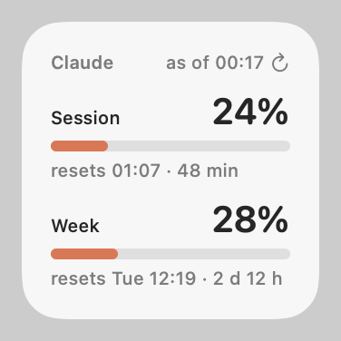
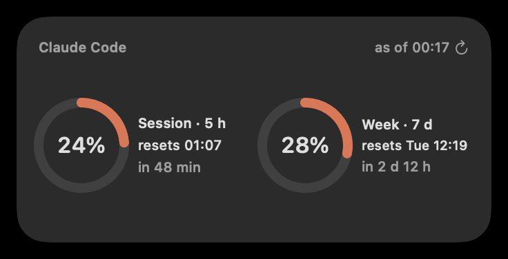
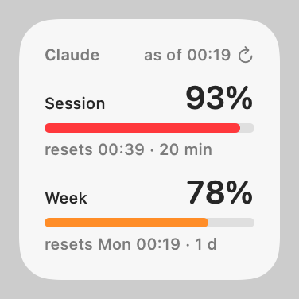

# Claude Usage Bar

**English** · [Українська](README.uk.md) · [Русский](README.ru.md)

A macOS menu bar app and desktop widget that show your **Claude Code plan usage**: the 5-hour session limit and the weekly limit, with reset times.

> Unofficial personal project, not affiliated with or endorsed by Anthropic.

The UI is available in Ukrainian, English and Russian. It follows the system language, and you can switch it in the menu.

<p>
  
  
  
</p>

## What you get

- **Menu bar:** `24% · 28%` (session · week). The text turns orange at 75% and red at 90%. The menu shows both limits with bars and reset times, how fresh the data is, and items for refresh (⌘R), claude.ai usage settings, launch at login and the language.
- **Desktop widget (WidgetKit):** small (bars) and medium (rings), in light and dark mode. Click it to refresh it immediately.
- **Claude Code status line:** model, context usage and both limits with reset times, for example `Opus · ctx 34% · 5h 42% ↻23:50 · 7d 18% ↻Tue 11:00`.

## How it works

1. **Status line (official).** Claude Code passes `rate_limits` (5-hour and 7-day `used_percentage` and `resets_at`) to the [statusLine](https://code.claude.com/docs/en/statusline) command. This needs Claude Code 2.1.80 or later and a Claude Pro or Max plan. `statusline-usage.sh` prints the status line and merges these numbers into `~/.claude/usage-cache.json`. Several sessions can write at once, and an idle session reports older numbers. Usage only grows within a window, so for the same window the larger value wins, and a later reset time means a newer window.
2. **API fallback (unofficial).** The menu bar app reads that file every 15 s. If Claude Code hasn't reported for more than 2 minutes, the app asks the endpoint Claude Code's `/usage` uses (`GET https://api.anthropic.com/api/oauth/usage`), at most every 5 minutes. On errors it backs off up to 30 minutes, and it honours `Retry-After` on 429. The backoff and the last API numbers survive relaunches.
3. **Widget.** The app writes the merged numbers to `~/.claude/usage-widget.json` and asks WidgetKit to reload. WidgetKit gives a widget a daily reload budget (about 40–70), so the app reloads at most once a minute in short bursts and about once per 15 minutes sustained. The widget is sandboxed and only reads those two files. Its countdowns step every 5 minutes, and it drops to 0% when a window resets, both without reloads.
4. **Click to refresh.** Clicking the widget runs an App Intent. Taps don't count against the reload budget. The app fetches fresh numbers if Claude Code hasn't reported for a minute (at most one API call a minute), and the widget reloads right away.

## Privacy and caveats

- The OAuth access token is read from the macOS Keychain item `Claude Code-credentials` with `/usr/bin/security`, read-only.
  - It is sent only to `api.anthropic.com`.
  - It is never written to disk or logged. Requests use an ephemeral `URLSession` without a cache.
  - It is never refreshed: refresh tokens rotate, so refreshing it here would log Claude Code out. When the token has expired, the app waits until Claude Code renews it.
- `/api/oauth/usage` is undocumented, so it can change or rate-limit at any time. In that case the app keeps working from the status line data.
- Using your Claude Code login outside Claude Code is a gray area under Anthropic's terms. Use this at your own risk. There is currently no switch that turns the API fallback off.
- The app is ad-hoc signed and built locally. It is not notarized.

## Requirements

- macOS 14 or later (tested on macOS 26.6).
- Xcode (tested with 26.6) and [XcodeGen](https://github.com/yonaskolb/XcodeGen): `brew install xcodegen`.
- `jq` at `/usr/bin/jq`. It ships with macOS 15 and later. On macOS 14, install jq and change the `/usr/bin/jq` paths in `statusline-usage.sh` and `uninstall.sh`.
- Claude Code 2.1.80 or later, logged in with a Claude Pro or Max plan.

## Install

```sh
git clone https://github.com/Qbickkk/claude-code-usage-widget.git
cd claude-code-usage-widget
./build.sh
```

`build.sh` does the following:
- generates the Xcode project and builds it with an ad-hoc signature (no Apple developer account needed);
- installs the app to `/Applications/ClaudeUsageBar.app`;
- copies the status line script to `~/.claude/statusline-usage.sh`;
- starts the app.

Then point Claude Code at the script. The following command replaces any status line you already have:

```sh
jq --arg c "$HOME/.claude/statusline-usage.sh" '.statusLine = {type: "command", command: $c, padding: 0}' \
  ~/.claude/settings.json > ~/.claude/settings.json.new && mv ~/.claude/settings.json.new ~/.claude/settings.json
```

Numbers appear after the first Claude Code response. To add the widget: right-click the desktop, choose **Edit Widgets…**, search for **Claude** and drag it onto the desktop.

To rebuild after changes, run `./build.sh` again. If the widget goes black after a rebuild, click it, or remove it and add it again.

## Uninstall

```sh
./uninstall.sh
```

This removes the app and widget, the login item, the status line script and its data files, the saved app state, and the `statusLine` setting (only if it still points to this script).

## Development

| Path | Contents |
|---|---|
| `statusline-usage.sh` | Status line command (bash + jq) |
| `Shared/Usage.swift` | Logic shared by the app and the widget: merge rules, API and credential decoding, backoff, reload budget, formatting |
| `Shared/L10n.swift` | UI strings in Ukrainian, English and Russian, and the language choice |
| `App/main.swift` | Menu bar app (AppKit) |
| `Widget/` | WidgetKit extension (SwiftUI, App Intents) |
| `project.yml` | XcodeGen spec |

- Tests: `tests/run.sh` runs the status line merge tests and the Swift logic tests.
- Widget previews: `swiftc -o build/tests/render Shared/Usage.swift Shared/L10n.swift Widget/UsageViews.swift tests/render/main.swift && build/tests/render docs` renders PNGs like the ones above.
- Logs: `/usr/bin/log show --last 10m --predicate 'subsystem == "local.shulika-illia.claude-usage-bar"'`. In zsh, plain `log` is a shell builtin, so use the full path.
- Widget troubleshooting: `/usr/bin/log show --last 10m --predicate 'process == "chronod"' | grep claude-usage-bar`.
  - "Bundle version did not match" means a widget process from the previous build is still running. `build.sh` kills it.
  - A second copy of the app registered with LaunchServices (the Xcode build product) makes chronod ignore the widget. `build.sh` unregisters it.
  - Clicking the widget does nothing and the log says "There is no metadata for RefreshUsageIntent": App Intents are indexed by bundle id, so unregistering another copy of the app (for example a build in another folder) removed them. Quit and reopen the app, which registers itself again on launch.
- To change the bundle id, edit `project.yml`, the `Logger` subsystem in `App/main.swift`, `refreshNotification` in `Shared/Usage.swift`, and `BUNDLE_ID` in `uninstall.sh`.

## License

[MIT](LICENSE)
