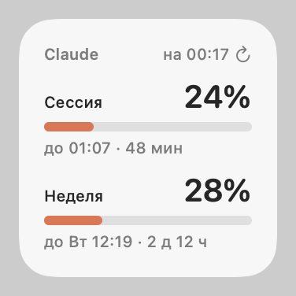
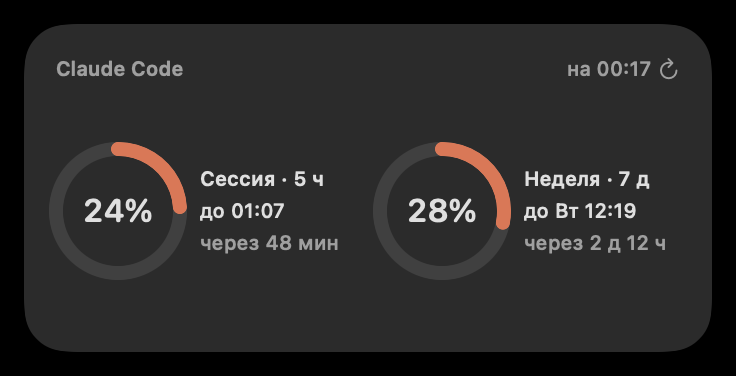
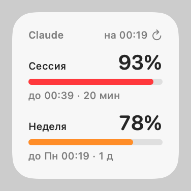

# Claude Usage Bar

[English](README.md) · [Українська](README.uk.md) · **Русский**

Приложение для строки меню macOS и виджет для рабочего стола, которые показывают **использование вашего плана Claude Code**: 5-часовой лимит сессии и недельный лимит, а также время их сброса.

> Неофициальный личный проект, не связанный с Anthropic и не одобренный ею.

Интерфейс доступен на украинском, английском и русском языках. По умолчанию используется язык системы, а переключить его можно в меню.

<p>
  
  
  
</p>

## Что вы получаете

- **Строка меню:** `24% · 28%` (сессия · неделя). Текст становится оранжевым при 75% и красным при 90%. В меню показаны оба лимита со шкалами и временем сброса, свежесть данных, а также пункты для обновления (⌘R), настроек использования на claude.ai, запуска при входе в систему и выбора языка.
- **Виджет на рабочем столе (WidgetKit):** маленький (шкалы) и средний (кольца), в светлом и тёмном оформлении. Нажмите на него, чтобы сразу его обновить.
- **Строка состояния Claude Code:** модель, использование контекста и оба лимита со временем сброса, например `Opus · ctx 34% · 5h 42% ↻23:50 · 7d 18% ↻Tue 11:00`.

## Как это работает

1. **Строка состояния (официально).** Claude Code передаёт команде [statusLine](https://code.claude.com/docs/en/statusline) данные `rate_limits` (`used_percentage` и `resets_at` для 5-часового и 7-дневного окон). Для этого нужен Claude Code 2.1.80 или новее и план Claude Pro или Max. `statusline-usage.sh` выводит строку состояния и объединяет эти числа с содержимым `~/.claude/usage-cache.json`. Несколько сессий могут записывать в файл одновременно, а неактивная сессия сообщает более старые числа. В пределах окна использование только растёт, поэтому для одного и того же окна побеждает большее значение, а более позднее время сброса означает более новое окно.
2. **Резервный вариант через API (неофициально).** Приложение в строке меню читает этот файл каждые 15 с. Если Claude Code не присылал данные более 2 минут, приложение обращается к тому же эндпоинту, что и команда `/usage` в Claude Code (`GET https://api.anthropic.com/api/oauth/usage`), не чаще раза в 5 минут. При ошибках приложение увеличивает задержку между запросами вплоть до 30 минут, а при ответе 429 учитывает `Retry-After`. Текущая задержка и последние числа из API сохраняются между перезапусками.
3. **Виджет.** Приложение записывает объединённые числа в `~/.claude/usage-widget.json` и просит WidgetKit перезагрузить виджет. WidgetKit выделяет виджету суточный бюджет перезагрузок (примерно 40–70), поэтому при коротких всплесках приложение перезагружает виджет не чаще раза в минуту, а при длительной активности — примерно раз в 15 минут. Виджет работает в песочнице и читает только эти два файла. Его обратные отсчёты обновляются с шагом 5 минут, а при сбросе окна он опускается до 0% — и то и другое без перезагрузок.
4. **Обновление по нажатию.** Нажатие на виджет запускает App Intent. Нажатия не расходуют бюджет перезагрузок. Приложение получает свежие числа, если Claude Code не присылал данные в течение минуты (не более одного запроса к API в минуту), и виджет сразу перезагружается.

## Конфиденциальность и оговорки

- OAuth-токен доступа читается из объекта Keychain macOS `Claude Code-credentials` с помощью `/usr/bin/security` в режиме только для чтения.
  - Он отправляется только на `api.anthropic.com`.
  - Он никогда не записывается на диск и не попадает в логи. Запросы выполняются через эфемерную сессию `URLSession` без кэша.
  - Он никогда не обновляется: refresh-токены ротируются, поэтому, если обновить его здесь, Claude Code выйдет из учётной записи. Если срок действия токена истёк, приложение ждёт, пока Claude Code его обновит.
- `/api/oauth/usage` не задокументирован, поэтому в любой момент может измениться или начать ограничивать частоту запросов. В этом случае приложение продолжит работать на данных из строки состояния.
- Использование вашей учётной записи Claude Code за пределами Claude Code — серая зона с точки зрения условий использования Anthropic. Используйте на свой страх и риск. Сейчас нет переключателя, который отключал бы резервный вариант через API.
- Приложение подписано ad-hoc и собрано локально. Оно не прошло нотаризацию.

## Требования

- macOS 14 или новее (проверено на macOS 26.6).
- Xcode (проверено на версии 26.6) и [XcodeGen](https://github.com/yonaskolb/XcodeGen): `brew install xcodegen`.
- `jq` по пути `/usr/bin/jq`. Он входит в состав macOS 15 и новее. В macOS 14 установите jq и измените пути `/usr/bin/jq` в `statusline-usage.sh` и `uninstall.sh`.
- Claude Code 2.1.80 или новее, в котором выполнен вход с учётной записью на плане Claude Pro или Max.

## Установка

```sh
git clone https://github.com/Qbickkk/claude-code-usage-widget.git
cd claude-code-usage-widget
./build.sh
```

`build.sh` выполняет следующее:
- генерирует проект Xcode и собирает его с ad-hoc-подписью (учётная запись разработчика Apple не нужна);
- устанавливает приложение в `/Applications/ClaudeUsageBar.app`;
- копирует скрипт строки состояния в `~/.claude/statusline-usage.sh`;
- запускает приложение.

Затем укажите Claude Code путь к скрипту. Следующая команда заменяет уже настроенную строку состояния, если она есть:

```sh
jq --arg c "$HOME/.claude/statusline-usage.sh" '.statusLine = {type: "command", command: $c, padding: 0}' \
  ~/.claude/settings.json > ~/.claude/settings.json.new && mv ~/.claude/settings.json.new ~/.claude/settings.json
```

Числа появятся после первого ответа Claude Code. Чтобы добавить виджет, нажмите правой кнопкой мыши на рабочем столе, выберите **Изменить виджеты…**, найдите **Claude** и перетащите виджет на рабочий стол.

Чтобы пересобрать приложение после изменений, снова запустите `./build.sh`. Если после пересборки виджет стал чёрным, нажмите на него или удалите его и добавьте заново.

## Удаление

```sh
./uninstall.sh
```

Эта команда удаляет приложение и виджет, объект входа, скрипт строки состояния и его файлы данных, сохранённое состояние приложения, а также настройку `statusLine` (только если она всё ещё указывает на этот скрипт).

## Разработка

| Путь | Содержимое |
|---|---|
| `statusline-usage.sh` | Команда строки состояния (bash + jq) |
| `Shared/Usage.swift` | Логика, общая для приложения и виджета: правила объединения, декодирование ответов API и учётных данных, задержка повторных запросов, бюджет перезагрузок, форматирование |
| `Shared/L10n.swift` | Строки интерфейса на украинском, английском и русском языках и выбор языка |
| `App/main.swift` | Приложение для строки меню (AppKit) |
| `Widget/` | Расширение WidgetKit (SwiftUI, App Intents) |
| `project.yml` | Спецификация XcodeGen |

- Тесты: `tests/run.sh` запускает тесты объединения данных в скрипте строки состояния и тесты логики на Swift.
- Превью виджета: `swiftc -o build/tests/render Shared/Usage.swift Shared/L10n.swift Widget/UsageViews.swift tests/render/main.swift && build/tests/render docs` рендерит PNG, подобные приведённым выше.
- Логи: `/usr/bin/log show --last 10m --predicate 'subsystem == "local.shulika-illia.claude-usage-bar"'`. В zsh просто `log` — встроенная команда оболочки, поэтому используйте полный путь.
- Устранение неполадок с виджетом: `/usr/bin/log show --last 10m --predicate 'process == "chronod"' | grep claude-usage-bar`.
  - «Bundle version did not match» означает, что процесс виджета из предыдущей сборки всё ещё запущен. `build.sh` завершает его.
  - Если в LaunchServices зарегистрирована вторая копия приложения (продукт сборки Xcode), chronod игнорирует виджет. `build.sh` отменяет её регистрацию.
- Чтобы изменить bundle id, отредактируйте `project.yml`, подсистему `Logger` в `App/main.swift`, `refreshNotification` в `Shared/Usage.swift` и `BUNDLE_ID` в `uninstall.sh`.

## Лицензия

[MIT](LICENSE)
