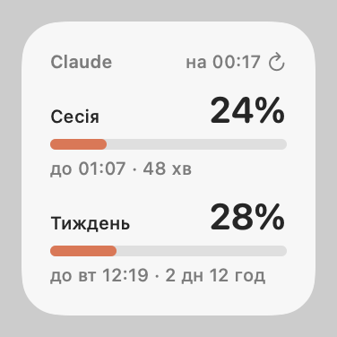
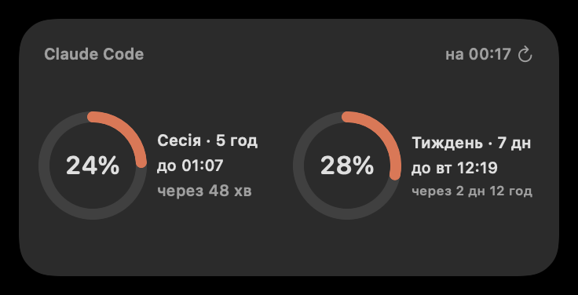
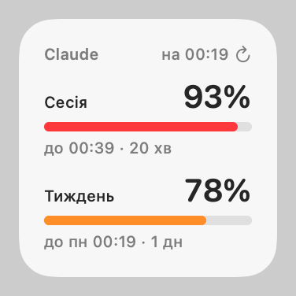

# Claude Usage Bar

[English](README.md) · **Українська** · [Русский](README.ru.md)

Програма для смуги меню macOS і віджет для робочого столу, які показують **використання вашого плану Claude Code**: 5-годинний ліміт сесії та тижневий ліміт разом із часом скидання.

> Неофіційний особистий проєкт, не пов’язаний з компанією Anthropic і не схвалений нею.

Інтерфейс доступний українською, англійською та російською. Він використовує мову системи, а змінити мову можна в меню.

<p>
  
  
  
</p>

## Що ви отримуєте

- **Смуга меню:** `24% · 28%` (сесія · тиждень). Текст стає помаранчевим від 75% і червоним від 90%. У меню показано обидва ліміти зі смужками та часом скидання, актуальність даних, а також пункти для оновлення (⌘R), переходу до налаштувань використання на claude.ai, запуску під час входу та вибору мови.
- **Віджет на робочому столі (WidgetKit):** малий (смужки) і середній (кільця), у світлому й темному режимах. Клацніть віджет, щоб одразу його оновити.
- **Рядок стану Claude Code:** модель, використання контексту та обидва ліміти з часом скидання, наприклад `Opus · ctx 34% · 5h 42% ↻23:50 · 7d 18% ↻Tue 11:00`.

## Як це працює

1. **Рядок стану (офіційно).** Claude Code передає `rate_limits` (`used_percentage` і `resets_at` для 5-годинного та 7-денного вікон) команді [statusLine](https://code.claude.com/docs/en/statusline). Для цього потрібні Claude Code версії 2.1.80 або новішої та план Claude Pro чи Max. `statusline-usage.sh` виводить рядок стану й об’єднує ці числа в `~/.claude/usage-cache.json`. Кілька сесій можуть записувати одночасно, а неактивна сесія повідомляє старіші числа. У межах вікна використання лише зростає, тому для того самого вікна перемагає більше значення, а пізніший час скидання означає новіше вікно.
2. **Резервний варіант через API (неофіційно).** Програма в смузі меню читає цей файл кожні 15 с. Якщо Claude Code не надсилав даних понад 2 хвилини, програма звертається до ендпоінта, який використовує `/usage` у Claude Code (`GET https://api.anthropic.com/api/oauth/usage`), не частіше ніж раз на 5 хвилин. У разі помилок вона поступово збільшує паузу між запитами до 30 хвилин і враховує `Retry-After` у відповіді 429. Поточна пауза після помилок і останні числа з API зберігаються після перезапуску.
3. **Віджет.** Програма записує об’єднані числа в `~/.claude/usage-widget.json` і просить WidgetKit перезавантажити віджет. WidgetKit виділяє віджету денний ліміт перезавантажень (приблизно 40–70), тому під час коротких сплесків активності програма перезавантажує віджет не частіше ніж раз на хвилину, а за тривалої активності — приблизно раз на 15 хвилин. Віджет працює в пісочниці й лише читає ці два файли. Його зворотні відліки змінюються кожні 5 хвилин, а коли вікно скидається, показник падає до 0% — і те, й інше без перезавантажень.
4. **Оновлення клацанням.** Клацання по віджету запускає App Intent. Такі клацання не зараховуються до ліміту перезавантажень. Програма отримує свіжі числа, якщо Claude Code не надсилав даних протягом останньої хвилини (не більше одного звернення до API на хвилину), і віджет одразу перезавантажується.

## Конфіденційність і застереження

- Токен доступу OAuth зчитується з елемента `Claude Code-credentials` у macOS Keychain за допомогою `/usr/bin/security`, лише для читання.
  - Він надсилається лише на `api.anthropic.com`.
  - Він ніколи не записується на диск і не потрапляє в журнали. Запити використовують ефемерну `URLSession` без кешу.
  - Він ніколи не оновлюється: токени оновлення змінюються після кожного використання, тому оновлення токена тут призвело б до виходу з облікового запису в Claude Code. Коли термін дії токена сплив, програма чекає, доки Claude Code його поновить.
- Ендпоінт `/api/oauth/usage` не задокументований, тому може будь-коли змінитися або почати обмежувати частоту запитів. У такому разі програма продовжує працювати з даними рядка стану.
- Використання вашого входу в Claude Code поза Claude Code — сіра зона з погляду умов використання Anthropic. Використовуйте це на власний ризик. Наразі немає перемикача, який вимикає резервний варіант через API.
- Програма має ad-hoc підпис і збирається локально. Вона не пройшла нотаризацію.

## Вимоги

- macOS 14 або новіша (перевірено на macOS 26.6).
- Xcode (перевірено з версією 26.6) і [XcodeGen](https://github.com/yonaskolb/XcodeGen): `brew install xcodegen`.
- `jq` за шляхом `/usr/bin/jq`. Він входить до складу macOS 15 і новіших версій. На macOS 14 встановіть jq і змініть шляхи `/usr/bin/jq` у `statusline-usage.sh` та `uninstall.sh`.
- Claude Code версії 2.1.80 або новішої, у якому виконано вхід з планом Claude Pro чи Max.

## Встановлення

```sh
git clone https://github.com/Qbickkk/claude-code-usage-widget.git
cd claude-code-usage-widget
./build.sh
```

`build.sh` виконує таке:
- генерує проєкт Xcode і збирає його з ad-hoc підписом (обліковий запис розробника Apple не потрібен);
- встановлює програму в `/Applications/ClaudeUsageBar.app`;
- копіює скрипт рядка стану в `~/.claude/statusline-usage.sh`;
- запускає програму.

Потім укажіть цей скрипт у налаштуваннях Claude Code. Наведена нижче команда замінює будь-який рядок стану, який у вас уже налаштовано:

```sh
jq --arg c "$HOME/.claude/statusline-usage.sh" '.statusLine = {type: "command", command: $c, padding: 0}' \
  ~/.claude/settings.json > ~/.claude/settings.json.new && mv ~/.claude/settings.json.new ~/.claude/settings.json
```

Числа з’являться після першої відповіді Claude Code. Щоб додати віджет, клацніть правою кнопкою на робочому столі, виберіть **Редагувати віджети…**, знайдіть **Claude** і перетягніть його на робочий стіл.

Щоб перезібрати програму після змін, знову запустіть `./build.sh`. Якщо після перезбирання віджет стає чорним, клацніть його або вилучіть і додайте знову.

## Видалення

```sh
./uninstall.sh
```

Ця команда видаляє програму й віджет, елемент входу, скрипт рядка стану та його файли даних, збережений стан програми, а також налаштування `statusLine` (лише якщо воно досі вказує на цей скрипт).

## Розробка

| Шлях | Вміст |
|---|---|
| `statusline-usage.sh` | Команда рядка стану (bash + jq) |
| `Shared/Usage.swift` | Логіка, спільна для програми й віджета: правила об’єднання, декодування відповідей API та облікових даних, пауза після помилок (backoff), ліміт перезавантажень, форматування |
| `Shared/L10n.swift` | Рядки інтерфейсу українською, англійською та російською, а також вибір мови |
| `App/main.swift` | Програма для смуги меню (AppKit) |
| `Widget/` | Розширення WidgetKit (SwiftUI, App Intents) |
| `project.yml` | Специфікація XcodeGen |

- Тести: `tests/run.sh` запускає тести об’єднання для рядка стану та тести логіки на Swift.
- Попередній перегляд віджета: `swiftc -o build/tests/render Shared/Usage.swift Shared/L10n.swift Widget/UsageViews.swift tests/render/main.swift && build/tests/render docs` створює PNG-зображення, подібні до наведених вище.
- Журнали: `/usr/bin/log show --last 10m --predicate 'subsystem == "local.shulika-illia.claude-usage-bar"'`. У zsh звичайний `log` — це вбудована команда оболонки, тому вказуйте повний шлях.
- Діагностика віджета: `/usr/bin/log show --last 10m --predicate 'process == "chronod"' | grep claude-usage-bar`.
  - "Bundle version did not match" означає, що процес віджета з попередньої збірки досі працює. `build.sh` завершує його.
  - Через другу копію програми, зареєстровану в LaunchServices (продукт збірки Xcode), chronod ігнорує віджет. `build.sh` скасовує її реєстрацію.
- Щоб змінити bundle id, відредагуйте `project.yml`, підсистему `Logger` у `App/main.swift`, `refreshNotification` у `Shared/Usage.swift` і `BUNDLE_ID` в `uninstall.sh`.

## Ліцензія

[MIT](LICENSE)
